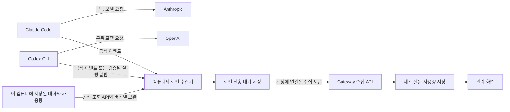

# 구독 기반 Claude / Codex 모니터링 접근 검토

검토일: 2026-10-07. 대상: Claude Code 및 Codex CLI의 구독 사용. 이 문서는 권장 구조를 검토한 보고서이며, 구현 완료나 설정 적용을 의미하지 않는다.

## 권장안

사용자가 자기 컴퓨터의 수집기를 Gateway 계정에 한 번 연결하는 방식을 권장한다. 수집기는 공식 이벤트와 그 컴퓨터에 남아 있는 대화·사용량 기록을 함께 읽어 Gateway로 보낸다. 사용자는 기존 Claude / Codex와 구독 로그인을 계속 사용한다.

사용자가 원하는 결과는 `Gateway 사용자 → 공급자 계정 → 세션 → 질문 → 사용량·환산 비용`이다. 사용자 화면에서는 공급자 계정을 세션 목록의 필터로 줄여 `계정 → 세션 → 질문`으로 표현할 수 있다. 모델 요청의 base URL은 그대로 두고, 수집 주소와 수집기 등록만 설정한다.

핵심은 이벤트 전송 설정을 더 많이 받는 것이 아니라, 수집기가 설정·과거 기록 읽기·중복 제거·전송 재시도를 맡게 하는 것이다. 서버의 수집 모델부터 고친 뒤 이 수집기를 붙이면 작은 단계로 구현할 수 있다.

## 선택지 비교

| 접근 | 사용자 부담 | 얻을 수 있는 것 | 주요 한계 | 판단 |
|---|---|---|---|---|
| 공식 OTel을 Gateway에 직접 전송 | CLI별 설정 한 번 | 새 사용량, Claude 질문 연결 | 과거 기록 없음; 이번 Codex OTel에는 턴 ID 없음 | 서버의 첫 단계와 간단한 사용량 모드에 적합 |
| 로컬 수집기 + 공식 이벤트 + 저장 기록 | 설치·Gateway 연결 한 번 | 새 대화, 발견 가능한 과거 기록, 재전송, 여러 기기 집계 | 로컬 실행과 버전별 사용량 어댑터 관리 필요 | 전체 요구에 가장 적합 |
| Codex App Server로 실행을 관리하는 별도 클라이언트 | 실행 경로 연결 또는 UI 개발 | 관리하는 실행의 구조화된 턴·사용량 | 기존 독립 실행의 자동 관측은 보장되지 않음; 실험적 인터페이스 | 선택적 확장 |
| ccusage JSON 보고서를 주기적으로 전송 | 로컬 도구와 전송 작업 | 세션·기간별 사용량과 추정 비용을 빠르게 확인 | 문서화된 보고서는 사용자 인증과 질문 원장까지 제공하지 않음 | 빠른 비교·대조 도구 |

ccusage는 보관된 Claude / Codex 기록의 세션 보고서를 JSON으로 출력한다. 이를 먼저 사용하면 세션 단위 분석을 빨리 확인할 수 있다. 다만 이 프로젝트의 계정 연결·질문 본문·질문별 사용량은 별도로 만들어야 한다. 이번 검토에서는 ccusage를 설치하거나 실행하지 않았으며, 현재 버전 호환성을 보증하지 않는다. [세션 보고서](https://ccusage.com/guide/session-reports), [Codex 데이터 원천](https://ccusage.com/guide/codex/)

## 추가로 확인한 근거

앞선 [구독 전송 실측](../verification/2026-10-07-subscription-telemetry.md)에 이어, 이번에는 모델 추론을 추가 실행하지 않고 설치된 Codex의 스키마, 저장 기록의 필드와 중복, 격리된 과거 대화 조회를 확인했다. 계정 ID·이메일·대화 본문은 새 보고서와 evidence에 넣지 않았다.

| 확인 | 관측 결과 | 의미와 범위 |
|---|---|---|
| Codex 0.160.0의 `generate-json-schema --experimental` | `thread/tokenUsage/updated`에 `threadId`, `turnId`, `tokenUsage.last/total` 존재 | 실행을 관측하는 공식 프로토콜에 턴 식별자가 있음. 일반 CLI에 자동 연결된다는 증거는 아님 |
| 같은 버전의 저장 대화 `Turn` 스키마 | ID·상태·항목·시간이 있고 usage 필드는 없음 | 대화 조회만으로 과거 질문 토큰까지 얻을 수 있다고 주장할 수 없음 |
| 완료된 legacy 기록 복사본을 임시 Codex home에서 읽기 | `thread/read`, `thread/turns/list` 성공; 1턴, 질문·응답 2항목; usage 필드 없음 | 공식 과거 대화 읽기는 실행 없이 가능. 조회 대상 기록은 0.130.0-alpha.5의 legacy 형식 |
| paginated 기록의 JSONL만 복사한 조회 | 조회 성공 응답이나 0턴 | 별도 저장 DB를 복사하지 않은 실험이다. JSONL 복사만으로 모든 새 형식의 대화를 복원할 수 없음 |
| 현재 런타임 home의 daemon 조회 | 제어 소켓 없음으로 연결 실패 | 이번 환경에서 공유 daemon의 실시간 알림 연결은 검증되지 않음 |
| 로컬 Codex 0.160.0 paginated 기록 복사본의 사용량 | `token_usage_record`에 response / turn / root-turn / thread / session 식별자, 요청 사용량과 턴·스레드 누적값 존재 | 두 턴의 8개·2개 응답을 각각 합산한 값이 해당 턴의 마지막 누적값과 일치. 전체 10개 합계도 스레드 누적값과 일치. 모든 버전·재시도·분기의 보편 규칙은 아님 |
| 사용자가 지정한 Claude 과거 세션의 메타데이터 | 버전 2.1.267, assistant 164항목, 고유 message ID 80개, 고유 request ID 78개; 47개 message 그룹이 반복 | 파일 줄마다 사용량을 더하면 중복 발생. 메시지와 요청의 관계도 일대일로 가정하면 안 됨 |

복사본을 조회하는 App Server는 로그인 정보 없이 임시 home에서 실행했으며, `thread/start`, `thread/resume`, `turn/start`를 보내지 않았다. 원본 기록과 개인 설정은 수정하지 않았고 임시 조회 프로세스는 종료했다. 새 검토 evidence는 [별도 JSON](2026-10-07-subscription-monitoring-approach-evidence.json)에 요약했다.

## 수집 구조

수집기는 CLI의 모델 로그인 정보를 서버로 보내지 않는다. Gateway 등록 토큰은 수집 용도이며, 공급자 인증과 별개다. 공식 API가 제공하는 로컬 대화 읽기와 모델 실행 API를 구분한다.

### Claude

새 질문과 호출의 연결에는 공식 OTel 로그의 `session.id`와 `prompt.id`를 쓴다. 한 질문이 여러 호출·도구 실행을 일으켜도 같은 prompt ID로 연결할 수 있다. 사용량은 `api_request`의 입력·출력·캐시와 비용 추정값을 우선한다. 과거 내용은 공식 SDK의 `listSessions` / `getSessionMessages`를 먼저 검토하고, API에서 빠지는 식별자·사용량만 버전별 보완 대상으로 둔다. [공식 이벤트](https://code.claude.com/docs/en/monitoring-usage), [공식 세션 조회](https://code.claude.com/docs/en/agent-sdk/sessions)

선택적 hook은 질문 시작·종료·하위 에이전트를 알려준다. `prompt_id`와 transcript 경로를 사용할 수 있지만, 종료 hook 시점에 파일 쓰기가 끝났다고 가정하지 않는다. hook은 가까운 로컬 큐에 기록하고 정상 반환하며, 원격 서버 응답을 기다리게 하지 않는 방향이 적합하다. [공식 hook](https://code.claude.com/docs/en/hooks)

과거 assistant 항목은 같은 API 응답을 여러 줄로 저장할 수 있다. SDK가 스트리밍으로 제공하는 assistant 사용량에는 출력 토큰의 임시값이 들어갈 수 있다. 이 SDK 설명을 모든 버전의 저장 JSONL 출력값이 부정확하다는 주장으로 확대하지 않는다. 이번 과거 파일에는 상당한 출력값과 `cost-state`도 있었다. 형식별로 요청 ID, message ID, 최종 사용량과 세션 요약을 대조한 후 신뢰 수준을 정해야 한다. [SDK 사용량의 범위와 중복](https://code.claude.com/docs/en/agent-sdk/cost-tracking)

### Codex

대화와 질문 식별은 공식 App Server의 thread / turn을 우선 검토한다. 과거 조회에는 `thread/read` 또는 지원되는 페이지 조회를 쓰고, 저장 사용량은 설치 버전에서 확인한 accounting 기록으로 보완한다. API와 파일의 식별자를 연결할 수 없는 항목은 미귀속 상태로 남긴다. [공식 App Server](https://learn.chatgpt.com/docs/app-server)

0.160.0의 이번 로컬 샘플에는 요청별 `usage`, `turn_token_usage`, `thread_token_usage`가 같이 있었다. 요청값을 합산하고 누적값과 대조하되, 세 종류를 함께 더하지 않는다. 이전 형식의 `event_msg/token_count`는 누적·최근 요청 의미와 재개·부모 기록 재사용을 따로 검증해야 한다. 내부 파일 형식은 공식 장기 호환 계약으로 취급하지 않는다.

Codex의 공식 `UserPromptSubmit` / `Stop` hook은 `turn_id`를 제공한다. 질문 경계를 보완할 수 있지만 hook 자체가 토큰 사용량 원천은 아니다. OTel 완료 이벤트를 단순히 가까운 질문 시간에 붙여 정확한 집계라고 표시하지 않는다. [공식 hook](https://learn.chatgpt.com/docs/hooks)

사용자가 원할 때는 기존 Codex TUI를 App Server에 연결하는 실행 방식도 검토할 수 있다. 해당 실행의 알림을 받는 경로를 실제 검증한 뒤 지원한다. 독립 실행 중인 CLI를 새 서버로 자동 감시하는 기능을 전제하지 않는다. `--ephemeral` 같은 비저장 실행은 검증된 공식 실행 알림이나 `codex exec --json` 수집 경로가 있어야 질문별 사용량을 지원한다. [CLI 연결 옵션](https://learn.chatgpt.com/docs/developer-commands), [JSON 실행 결과](https://learn.chatgpt.com/docs/non-interactive-mode)

## 사용자에게 필요한 실제 설정

제품이 완성되면 사용자의 절차는 다음처럼 줄일 수 있다. 아래 절차와 자동 설정 도구는 현재 구현돼 있다는 뜻이 아니다.

1. Gateway에 로그인해 컴퓨터를 연결한다. 서버가 사용자·컴퓨터에 연결된 수집 토큰을 발급한다.
2. 로컬 수집기에서 Claude / Codex 저장 위치를 확인한다. 실제 런타임 home을 사용하며 `~/.codex` 하나로 고정하지 않는다.
3. 새 사용량 수집과 질문 본문 수집을 선택한다. 질문 화면을 원하면 본문 수집을 켠다. 과거 기록은 발견된 기간·세션 수를 보여주고 가져올 범위를 정한다.
4. 연결 도구가 필요한 OTel 주소·헤더·본문 옵션과 선택적 hook만 병합한다. 기존 hook / statusline / 모델 / 로그인 설정을 보존하고 변경 내역과 되돌리기를 제공한다.
5. 설정을 읽는 CLI 프로세스를 새로 시작하고 연결 상태를 확인한다. 이후 평소처럼 `claude`, `codex`를 사용한다.

사용자에게 여러 환경변수를 직접 복사시키기보다, 연결 도구가 앞선 실측 설정을 적용하게 하는 것이다. 수집 주소는 로컬 수집기를 향하고, 로컬 수집기가 Gateway 주소와 토큰을 관리한다. 향후 설정 적용은 실제 로그인 모드와 CLI/IDE별 설정 전파도 검증해야 한다.

현재 `scripts/claude-monitor.py`는 사용량 전용 실행기이며 `OTEL_LOG_USER_PROMPTS=0`을 강제한다. 이 실행기를 그대로 사용하면 질문 본문 화면은 채워지지 않는다. 기존 사용량 모드는 유지하고, 본문 수집을 명시적으로 선택하는 모드를 추가하는 편이 적합하다.

## 서버에서 먼저 바꿀 부분

현재 문제는 전송보다 저장 의미다. 중앙 서버의 기반을 먼저 확정해야 로컬 수집기가 보내는 데이터를 잃지 않는다.

| 현재 코드 | 확인된 제약 | 필요한 확장 |
|---|---|---|
| `TelemetryNormalizer.java:29,49-55` | 계정·prompt 필드 제외, 질문·Codex 이벤트 건너뜀 | 공급자별 어댑터, 질문·사용량의 별도 정규화 |
| `CollectorCredentialService.java:30,91-99` | 인증 결과에 tenant·credential·billing만 있음 | 사용자·컴퓨터와의 안정적인 연결 |
| `AnalyticsRecord.java:79-102`, `V1__analytics.sql:27` | source 제한, 요청 중심 insert-once | 대화·턴과 사용량 관측 저장 및 갱신 가능한 조회 결과 |
| `AnalyticsQueries.java:28-35`, `AdminFilters.java:30-31` | Claude 중심 비용·source 처리 | 양 CLI의 사용량·환산 비용·미확정 상태 |
| `AdminController.java:44-48` | 기존 내용 읽기 권한·감사 기록 | 질문·과거 본문 읽기에도 재사용 |
| `JsonlIngestor.java:105-159` | offset·파일 anchor·checkpoint 패턴 존재 | 로컬 사용량 읽기의 복구 설계에 참고 |

Java 경로는 `llm-gateway-api/src/main/java/dev/rojae/llmgateway/analytics/`, SQL은 `llm-gateway-api/src/main/resources/db/migration/` 기준이다.

현재 `TelemetryController.java:60-80`은 지원 레코드를 DB에 commit한 뒤 200을 반환한다. 내구성 있는 응답의 기반은 이미 있다. 다만 건너뛴 질문·Codex 이벤트가 거절 수에도 포함되지 않아 빈 저장 후 성공할 수 있다. 지원·무시·거절·중복 건수를 관리 상태에 보여주고, OTLP 응답은 프로토콜에 맞게 유지한다. 연결 검사는 HTTP 200과 함께 기대한 질문·사용량의 저장 여부를 확인해야 한다.

대규모 새 플랫폼보다 다음 정보를 기존 requests 옆에 추가하는 것으로 시작할 수 있다.

- Gateway 사용자와 컴퓨터 등록 관계
- 공급자 계정의 관측·연결 상태
- 세션, 질문/턴, 메시지와 부모·분기 관계
- 사용량 원천, 외부 식별자, 적용 범위, 증분/누적 의미, CLI·어댑터 버전
- 최종 질문 사용량과 수집 완전성

### 계정 연결

데이터 소유자는 인증된 수집 토큰의 Gateway 사용자로 정한다. 이벤트의 이메일이나 공급자 ID 문자열만 보고 내부 사용자 권한을 결정하지 않는다. 공급자 계정 식별자는 추가 연결 정보다.

과거 기록의 작성 계정과 현재 로그인 계정은 다를 수 있다. 과거 기록에 작성 계정 증거가 없으면 소유 컴퓨터를 등록한 사용자에게 가져오되, 공급자 계정은 미확인으로 표시한다. 같은 구독 계정을 여러 사람이 공유하면 그 공급자 ID만으로 실제 질문한 사람을 알아낼 수 없다.

수집 토큰을 재발급해도 사용자·컴퓨터·세션 ID가 바뀌지 않게 한다. 같은 세션이 여러 컴퓨터에서 관측되면 검증 가능한 외부 식별자로 중복을 제거하고, 컴퓨터는 관측 출처로 남긴다. 서로 다른 사용자의 데이터는 인증 범위를 넘어 자동 병합하지 않는다.

### 사용량 합계

질문 하나에는 여러 호출과 도구·하위 에이전트 활동이 들어갈 수 있다. 질문 본문 길이와 실제 모델 입력 토큰은 다르다. 자동 이어가기 질문도 사람이 직접 입력한 질문과 구분할 수 있어야 한다.

각 관측에는 `scope=response|turn|thread`와 `semantics=delta|snapshot`을 기록한다. 같은 사용량을 OTel·파일·공식 알림에서 다시 봤다고 세 번 더하지 않는다. 요청 ID와 턴 ID로 연결하고, 확정된 한 원천을 합계에 반영한 뒤 다른 원천은 대조에 사용한다.

누적값의 차분은 초기 기준과 범위가 확인될 때만 계산한다. 더 큰 값이나 마지막 값을 무조건 선택하지 않는다. resume / fork / `/clear` / compaction / 하위 에이전트에는 별도 경계가 필요하다. fork로 복사된 문맥은 새 소비와 구분한다. 정밀하게 연결되지 않는 값은 세션의 미귀속 사용량으로 표시한다.

이번 구독 실측 Codex의 완료 이벤트 두 개를 더한 입력 41,717을 질문 확정 입력으로 쓰면 안 된다. CLI가 보고한 해당 턴 입력은 29,220이었다. 새 로컬 샘플에서 합계와 누적값이 일치했다는 결과가 이 이전 OTel 이벤트의 의미를 확정해 주지는 않는다.

## 비용·구독 한도 표시

| 화면 값 | 의미 | 수집 방법 |
|---|---|---|
| 질문 토큰 | 해당 질문 처리에 관측된 모델 사용량 | 확인된 요청 또는 턴 사용량 |
| API 단가 환산 비용 | 동일 사용량을 API 가격으로 환산한 비교값 | CLI 추정 또는 버전·적용 시점이 있는 가격표 |
| 공급자 크레딧 사용 추정 | 공급자가 제공하는 별도 usage/credit 추정 | 해당 공식 계정 API가 실제로 제공할 때 |
| 월 구독료 | 사용량과 별개인 계약 요금 | 사용자 입력 또는 승인된 청구 정보 |
| 질문별 배분 금액 | 월 구독료를 내부 기준으로 나눈 금액 | 선택한 배분 규칙; 실제 질문 청구액과 구분 |
| 남은 사용 한도 | 공급자의 현재 사용 창·리셋 기준 | 공식 제공 값이 있을 때; 토큰으로 역산하지 않음 |

Claude와 Codex의 캐시 토큰 포함 의미를 정규화해야 한다. Claude 입력값은 캐시 읽기·쓰기를 제외하지만, 이번 Codex 입력값에는 캐시 입력이 포함돼 있었다. reasoning도 출력의 부분집합이면 별도로 더하지 않는다. 기존 `observe/Pricing.java`를 재사용하려면 이 의미와 모델별 캐시 단가를 먼저 검증해야 한다.

모르는 모델·요금·서비스 티어는 비용을 0으로 채우지 않는다. `CLI 보고 추정`, `Gateway 계산 추정`, `부분 수집`, `계정 미확인`, `미귀속`을 구분한다. 과거 기록이 남아 있지 않으면 새 설정으로 복원할 수 없다.

Codex 공식 계정 usage API와 설치 스키마에는 계정 요약·기간 사용량과 일부 thread usage 추정 필드가 있다. 이번 계정에서의 응답·지원 여부는 확인하지 않았다. 이 값이 제공되더라도 질문 원장이나 실제 청구서를 대체하지 않는다. Claude statusline에도 비용·사용 한도 정보가 문서화돼 있지만, 이번 설치에서 실측하지 않았고 기존 statusline을 덮어쓸 근거로 삼지 않는다. [Codex 계정 조회](https://learn.chatgpt.com/docs/app-server), [Claude statusline](https://code.claude.com/docs/en/statusline)

## 작게 구현하는 순서와 검증 기준

첫 단계는 중앙 수집과 새 질문 화면이다. Claude 질문·prompt ID, Codex 사용량 어댑터, 사용자 연결을 저장하고 기존 실제 fixture를 재전송해 확인한다. Codex의 질문 사용량 근거가 부족하면 세션 단위 관측과 미확정 상태부터 제공한다.

두 번째 단계에서 로컬 수집기를 묶어 연결·설정을 자동화하고, 저장 대화의 가져오기와 사용량 보완을 추가한다. macOS에서는 앱 또는 사용자 서비스로 실행할 수 있지만, 초기 검증은 전경 실행으로도 충분하다. API 키·공급자 OAuth를 중앙 관리하는 기능을 이 단계의 전제 조건으로 넣지 않는다.

전송은 로컬 디스크 기록 후 재시도하고, 중앙의 내구성 있는 저장 응답을 받은 뒤 대기 기록을 제거한다. 큐가 꽉 차거나 디스크·재시도 한계에 걸리면 수집 상태에 표시한다. OpenTelemetry Collector의 저장 큐를 재사용하는 경로도 있지만 현재 Gateway의 OTLP HTTP/JSON 제약과 exporter 호환성을 먼저 확인해야 한다. Kafka 등 별도 인프라를 첫 단계에 추가할 필요는 없다. [OTel 저장 큐와 한계](https://opentelemetry.io/docs/collector/resiliency/)

필수 수용 기준:

1. 동일 배치·과거 기록을 반복 전송해 질문 수와 토큰이 증가하지 않는다. 수집 토큰 재발급에도 같은 데이터로 연결된다.
2. 다중 질문, 도구, 하위 에이전트, 취소·오류·재개·분기·압축 fixture에서 범위를 대조한다. 모호한 연결은 확정하지 않는다.
3. 요청 합계와 최종 턴 요약이 같거나, 차이와 원천이 화면에 드러난다. 알려진 Codex 구독 fixture의 CLI 합계 29,225와 OTel 차이를 숨기지 않는다.
4. 로컬/중앙 응답 직전·직후 중단과 재시작으로 수락된 데이터의 유실·중복을 검사한다. 원천 CLI가 기록·전송하지 못한 데이터까지 복구한다고 주장하지 않는다.
5. legacy / paginated 저장, 부분 파일 쓰기, 압축·회전, 다른 runtime home, archived 기록, 비저장 실행을 검사한다. 새 App/IDE가 자동 지원된다고 간주하지 않는다.
6. 가져온 기간·기기·형식·누락 이유를 보여준다. 데이터 삭제 후 재수입으로 본문이 되살아나지 않게 기존 삭제·권한·감사 정책을 연결한다.

이번에는 수집기·서버 기능을 구현하거나 개인 설정을 바꾸지 않았다. 검토의 종료 기준은 추천 경로, 실제 지원 근거, 검증되지 않은 부분과 다음 구현의 수용 기준이 분명해지는 것이었다.
